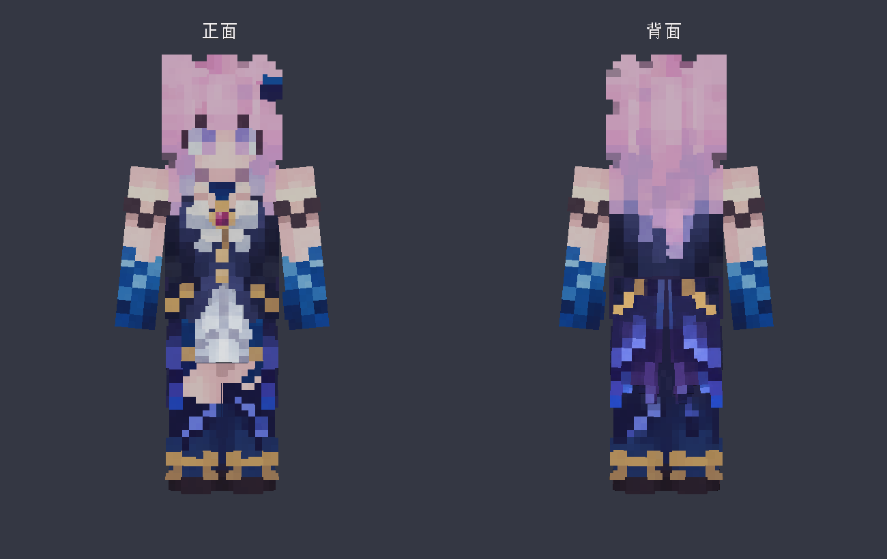

# 达妮娅 · Minecraft 旅行伙伴（Fabric）

达妮娅能跟你同船过河，在僵尸靠近时出手护卫。你可以请她「帮我做一把铁镐交给我」，看她备料、熔铁，把成品放进你的物品栏。你们一起吹过蜡烛的地方，隔天再回来，她还会记得。

这是 radala 基于 avilliai 的 `denia0.1.3` 开发的 `feat/travel-companion` 分支。跟随、战斗变身、同船和基础采集合成来自原作。这个分支完善了委托交付，加入旅行手记、双人营地、按 V 听写、Breeze 回话和蓝金二形态造型。[原作者仓库](https://github.com/avilliai/minecraft-denia) · [分支更新日志](CHANGELOG.md) · [图文说明书与实机截图](docs/达妮娅模组更新对照与版本说明.pdf)

## 下载与第一次游玩

| Minecraft Java 版 | 运行游戏所需 Java | 模组安装包 |
| --- | --- | --- |
| 1.21.11（主版本） | 21 | [1.21.11 的 JAR](lib/denia-0.1.0.jar) |
| 1.21 或 1.21.1 | 21 | [这两个版本共用的 JAR](lib/Fabric-1.21-1.21.1/denia-0.1.0-fabric-1.21-1.21.1.jar) |
| 1.20.1 | 17 | [1.20.1 的 JAR](lib/Fabric-1.20.1/denia-0.1.0-fabric-1.20.1.jar) |

1. 选上表对应的 JAR，在 GitHub 文件页点 **Download raw file**。用 Fabric Loader 启动对应的游戏版本，把这一份 JAR 和同游戏版本的 Fabric API 放入该实例的 `mods/`。已实测的 Loader 是 `0.19.3`。[各版本实测的 Fabric API](ports/README.md)
2. 进世界输入 `/denia summon`。想先试一条委托，可以给她 3 个铁锭和 2 根木棍，再输入 `/denia obtain minecraft:iron_pickaxe 1`。右键她可以查看背包和任务进度。
3. 想直接对她说话时，先在「接口配置」填好聊天服务，再启动本机 Whisper，按住 **V** 说话、松开核对、按 **Enter** 发送。想听她开口，再启用 Breeze 或 GPT-SoVITS 朗读。[聊天、听写与语音配置](#voice-setup)



*当前二形态，游戏客户端正背面对照。可编辑的 Blockbench 模型和导出方法见[模型目录](art/README.md)。*

## 和达妮娅一起旅行

- **第一次生日蛋糕**。在地上摆好原版蛋糕，插上任意颜色的蜡烛并点燃。你和自己的达妮娅都站在蛋糕 4 格内，双手空着，潜行右键她。她会吹熄蜡烛，蛋糕留给你们分享。你走出 24 格后，另一个游戏日与她一起回到 8 格内，等周围安静下来，她会认出这里。
- **旅行手记**。右键她，点「旅行手记」，或输入 `/denia journal`，可以翻阅最近的共同经历。第一块生日蛋糕单独保存，手记会记下地点和重访。手记与玩家和存档绑定。
- **生存委托**。对她说“帮我做一把铁镐交给我”，或输入 `/denia obtain minecraft:iron_pickaxe 1`。她会使用已有材料，根据需要采集、制作工具和炉子、备燃料，再合成并交货。附近有可达的树、石头和露天铁矿时可从空背包开始。右键看任务列表，缺料时可以补给她或带她换个地方，玩家背包腾出空位后可继续交货。
- **一起搭营**。让她站在平整空地中央，站在她 8 格内输入 `/denia camp`，或让她“和我搭个营地”。营地占 5×5 格，南面留门，需要畅通的出入口。全新的墙和顶需要 55 块常用建材，例如木板、原木、泥土或圆石，可混用。你砌好的实心墙和屋顶会抵扣建材。她先核对场地与背包，缺多少会告诉你。内部可自行摆放两张床。
- **本地听写**。按住 **V**，等「可以说话了」和音量条出现后开口，说完松开。草稿可修改，Enter 发送，Esc 取消。若声音太小，游戏会提示重试。按键可在游戏设置中更改。首次使用会生成 `config/mcgf-voice-input.json`，默认使用系统输入设备，并连接 `http://127.0.0.1:18765/inference`。多麦克风用户可在配置中的 `inputDevice` 填入 Java Sound 的录音设备名称。工作区的 Windows 启动器会启动中文听写和本地人声检测，普通启动器需要单独运行本机转录服务。
- **背包和装备**。保存世界、收进重逢符或复活都会保留新记录的槽位、耐久、附魔、命名和容器内容。旧格式能恢复其中已有的物品和数量。重逢符快照保存在各存档根目录的 `mcgf-downed.json`。只有一个已有世界时会自动迁移旧全局快照。若有多个世界且旧快照属于其中一个，请关闭游戏后将旧文件移到其原存档；如目标已存在同名文件，应先分别备份并核对归属。

## 其他功能

- **召唤伴随实体**：`/gf summon` 在身边生成一个人形伴随角色，绑定你为主人。
- **跟随 AI**：跟随主人、闲逛、看向玩家、自动浮水。
- **聊天接 LLM**：在其附近（默认 16 格内）发普通聊天 → 异步调用 LLM → 回复显示在
  聊天框，并触发语音。带 `follow` / `come` / `stop` 工具调用。
- **语音朗读**支持 Breeze 和 GPT-SoVITS。客户端收到台词后异步合成并播放 WAV。
- **可编辑配置**：首次运行生成 `config/mcgf.json`，可改 LLM/TTS 接口与人格，`/gf reload` 热重载。
## 命令

| 命令                        | 作用              |
|---------------------------|-----------------|
| `/gf summon`              | 在身边召唤伴随实体并绑定为主人 |
| `/gf come` / `/gf follow` | 让其过来 / 跟随你      |
| `/gf stop`                | 停在原地            |
| `/gf say <文本>`            | 让其说一句（测试语音/气泡）  |
| `/gf reload`              | 重新加载配置文件        |
| `/gf home`                | 设置家             |

直接在其附近聊天（不带 `/` 或 `!`）即可对话。

<a id="voice-setup"></a>

## 聊天、听写与语音配置

首次运行会生成 `config/mcgf.json`。

- `llm.baseURL`、`llm.apiKey` 和 `llm.model` 默认均为空。使用在线聊天时，填入服务方提供的兼容接口地址、密钥和模型名。也可通过环境变量 `MC_BOT_API_KEY` 或 `OPENAI_API_KEY` 提供密钥。
- `llm.systemPrompt`：人格设定（`{name}` 会替换为 `persona.displayName`）。
- `tts.url` 填完整语音接口地址，初始为空。作者网关的 Breeze 入口是 `http://api.apollodorus.xyz/v1/audio/speech`。在游戏内右键达妮娅，打开「接口配置」，填入 TTS 地址并打开语音。
- 使用 Breeze 时，客户端向该接口 POST 台词。语音地址与 `llm.baseURL` 的协议、主机和端口必须相同才能复用聊天密钥。作者的 HTTP 地址会以明文传输密钥和台词。
- `tts.model` 默认是 `breeze-tts-2`，`tts.voice` 默认是 `达妮娅`。在配置文件中可以切换到网关支持的其他音色。
- GPT-SoVITS 的 GET 接口使用 `tts.refAudioPath`、`tts.promptText`、`tts.promptLang`、`tts.textLang` 和 `tts.extraParams`。
- `behavior.chatRadius` / `followByDefault` / `moveSpeed` 等。

独立安装后需要按 V 听写时，可在本机启动 whisper.cpp 的 `whisper-server`。在模型所在目录执行以下命令，再进入游戏。将 `whisper-server` 加入 PATH，或使用它的完整路径。

```powershell
whisper-server --model ggml-small-q5_1.bin --host 127.0.0.1 --port 18765 --language zh
```

## 构建

```bash
./gradlew build          
./gradlew runClient      # 开发环境启动客户端测试
```

主工程构建产物为 `build/libs/denia-0.1.0.jar`。安装步骤见上方版本表。

### 本机构建环境说明（中国大陆网络）

由于 `github.com` 在本机不可达，且 MC 1.21.11 需要 JDK 21，本仓库做了如下适配：

- `gradle-wrapper.properties` 的 `distributionUrl` 指向腾讯云镜像
  （`mirrors.cloud.tencent.com/gradle`）。
- JDK 21 从清华 TUNA 的 Adoptium 镜像下载，解压到 `根目录/.jdks/`（已 gitignore）。
- `gradle.properties` 用 `org.gradle.java.home` 让 Gradle 守护进程跑在 JDK 21 上
  （Loom 1.16 要求），并关闭 foojay 自动下载（其源在 github）。

换到能直连 github 的环境时，可移除上述镜像/本地 JDK 设置，恢复标准 toolchain 自动下载。

在另一台 Windows 电脑克隆时，请先把 `JAVA_HOME` 指向自己的 JDK 21。主工程保留了作者本机的 JDK 路径，可以用 `./gradlew.bat "-Dorg.gradle.java.home=$env:JAVA_HOME" build` 覆盖。兼容版使用仓库内的同一个 Gradle Wrapper，命令见[兼容版开发说明](ports/README.md)。

## 玩法测试

运行 `./gradlew runGameTest` 可在 `build/run/gameTest` 的独立世界验证委托、营地、生日回忆和存档兼容。

运行 `./gradlew runClientGameTest` 会打开 Minecraft 客户端，在独立的单人生存世界里用鼠标和键盘输入测试庆生、旅行手记、铁镐交付和搭营。游戏截图保存在 `build/run/clientGameTest/screenshots/`。在本机项目目录下也可以运行 `..\Denia.cmd --offline runClientGameTest`。

四个版本合计执行 82 次服务端测试，全部通过。各版本客户端另行验证了进入单人世界和伙伴交互。[逐版本结果、故障复测与 JAR 校验值](output/companion-fixes/验证记录.md)

## 原作与素材

原作者 avilliai 在原版 README 里记录了制作动机、早期二形态皮肤、角色对话与语音方案的取舍。[原作者手记（固定到分支起点）](https://github.com/avilliai/minecraft-denia/blob/4d95c3f00be6bb24e766b0eefd7a3266c0a3ca67/README.md) · [原作注明的皮肤来源](https://namemc.com/skin/479cedd3e79bc95a)
